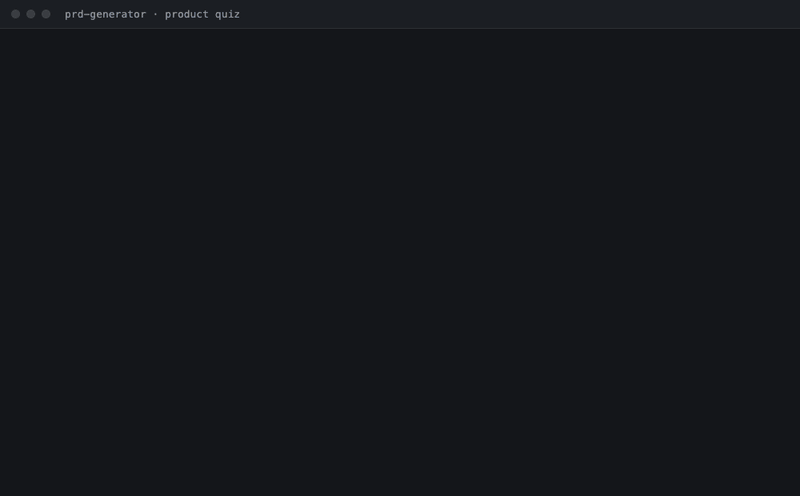

# rohit-skills

Agent skills I use for product work, grouped by discipline. Works with **Claude** (Claude Code and Claude.ai), **Codex**, **Cursor** and **Grok Bot**.



*A real run on a fictional product. [See the full showcase](product/skills/prd-generator/examples/shiftplate/).*

## Skills

| Discipline | Skill | What it does |
|---|---|---|
| **product** | [PRD Generator and Product Quiz Agent](product/skills/prd-generator/) | Quizzes you through the product questions (problem, PMF, north star, goals and non-goals, prioritisation), writes or reviews the PRD, then hands off a prototype prompt for a coding agent |

Each discipline is its own plugin (`rohit-skills › product › prd-generator`), so you can install only the area you need.

## Who it's for

PMs who need to spin up a PRD for the product or feature they're working on now, and want to get from idea to a testable prototype quickly:

- **You have an idea, notes or a call transcript** and need a PRD your team can commit to.
- **You need answers before requirements**: is there product–market fit, what's the north star, what are the goals and non-goals, and what do we build first.
- **You want to prototype straight away** by handing the PRD to a coding agent.

**Use it with deep research.** The PRD Generator works best after a research pass. Research gathers the market, competitor and user evidence; the PRD Generator turns it into decisions and labels every claim as sourced or assumed. Use a deep-research skill or your agent's own research tool, or paste in research you already have.

## Install

**Any agent, one line** (Claude Code, Codex, Cursor and others, via [skills.sh](https://skills.sh)):

```bash
npx skills add subrro11/rohit-skills
```

**Claude Code plugin**

```
/plugin marketplace add subrro11/rohit-skills
/plugin install product@rohit-skills
```

**Codex and Cursor, by hand**

Both read skills from `~/.agents/skills/`. Clone once and link, so a `git pull` picks up updates:

```bash
git clone https://github.com/subrro11/rohit-skills ~/rohit-skills
mkdir -p ~/.agents/skills
ln -s ~/rohit-skills/product/skills/prd-generator ~/.agents/skills/prd-generator
```

To install for one project only, link it into that repo's `.agents/skills/` instead.

**Grok**

Add `product/skills/prd-generator/SKILL.md` as a custom skill in Grok Bot, or attach the file and ask Grok to follow it. Grok Build reads skill folders from `~/.grok/skills/`: link the folder there as above.

**Claude.ai**

Zip the `product/skills/prd-generator/` folder (keep the folder name `prd-generator`) and upload it under Customize → Skills → Create skill → Upload a skill. Code execution must be on.

**Any other agent**

Point it at the skill's `SKILL.md`.

## Try this first

Paste this, with your own product in place of the example:

```
Quiz me on my product. <Product> is <what it does> for <who>.
```

It asks five questions one at a time, grades each answer, and ends with a scorecard. Then say *"Write the Lite PRD, then the prototype prompt."*

Other prompts: *"Write a PRD from these notes"*, *"What should our north star be?"*, *"Prioritise this backlog"*, *"Review this PRD"*. You can also call it directly: `/product:prd-generator` in Claude Code, `$prd-generator` in Codex.

## How the PRD Generator works

```
Problem → Product thinking → PRD → Prototype with a coding agent → Test → Revise
```

- **It works through the product questions first**: the problem, a PMF hypothesis with a proving signal, a north star and its inputs, goals and non-goals, and RICE prioritisation with logged overrides.
- **It writes the PRD from those answers.** The PRD leads with a recommendation, labels every number as sourced, assumed or fictional, splits scope into in scope, deferred and out of scope, and gives every P0 a testable acceptance criterion.
- **Then you prototype.** It writes `PROTOTYPE-PROMPT.md` for a coding agent to build the thinnest version of the core loop that tests the riskiest assumption. Test it with five users, then revise the PRD.

More detail is in the [skill README](product/skills/prd-generator/README.md).

## Changes

See [CHANGELOG.md](CHANGELOG.md).

## License

MIT
